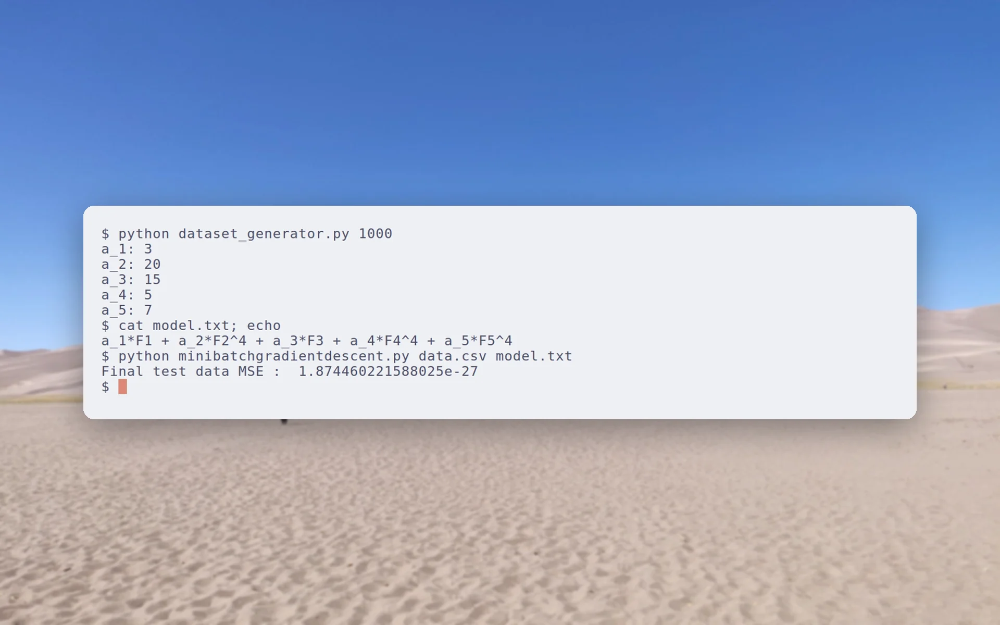
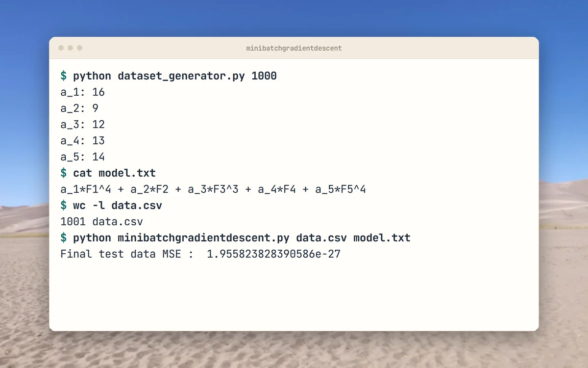
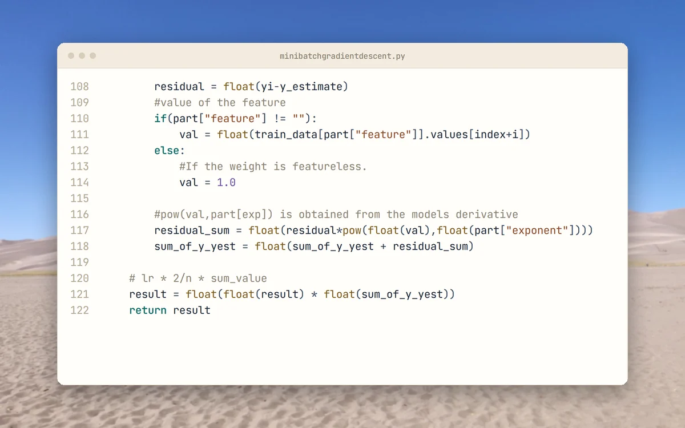
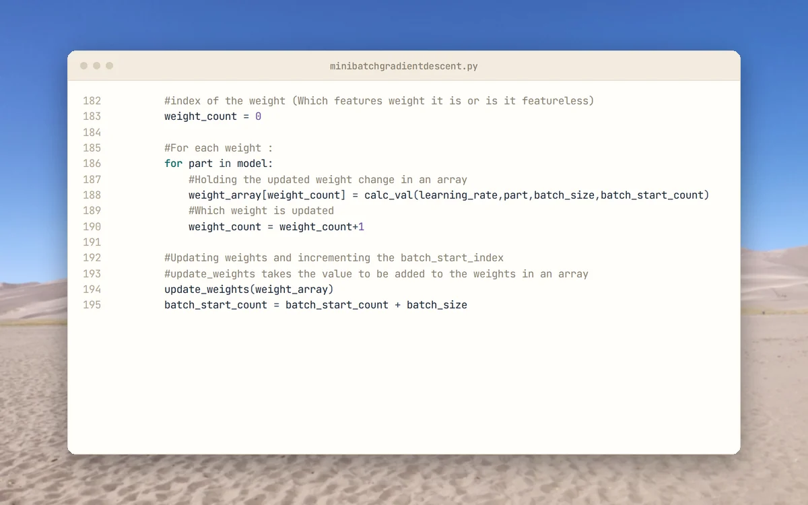
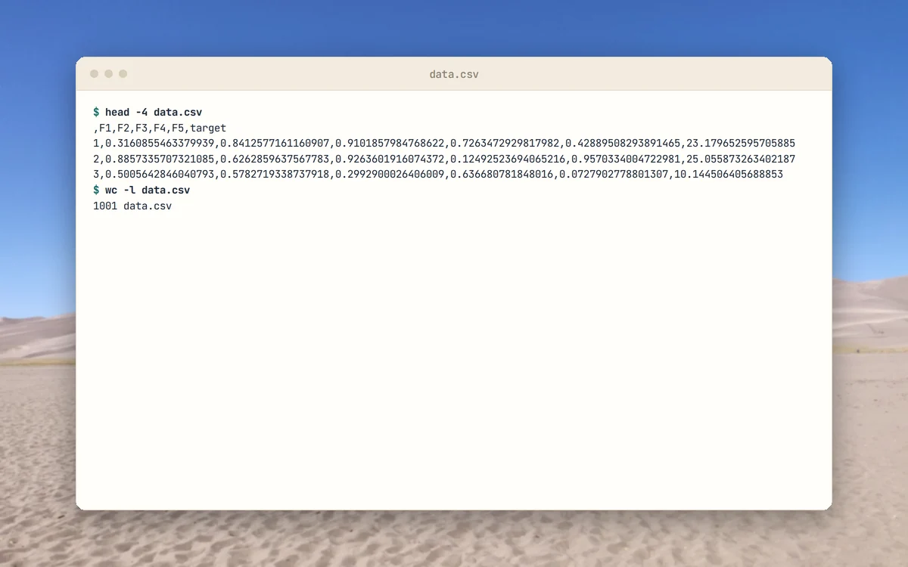

<p align="center">
  <picture>
    <source media="(prefers-color-scheme: dark)" srcset="docs/brand/svg/minibatch-gd-logo-on-dark.svg">
    
  </picture>
</p>

<h1 align="center">Gradient descent written from scratch.<br>A dataset generator is included.</h1>

<p align="center">
  Coursework from 2020: polynomial regression trained with mini-batch gradient descent.<br>
  <b>One model file. One CSV. A test MSE at the end.</b>
</p>

<p align="center">
  <a href="LICENSE"></a>
  
  
  
  <a href="https://github.com/mertkayacs/Mini-Batch-Gradient-Descent-Pure-Python"></a>
</p>

<p align="center">
  <a href="#quick-start"></a>
  <a href="minibatchgradientdescent.py"></a>
  <a href="dataset_generator.py"></a>
</p>

<p align="center">
  <picture>
    <source media="(prefers-color-scheme: dark)" srcset="docs/assets/readme/hero-dark.webp">
    
  </picture>
</p>

Mini-Batch Gradient Descent fits a polynomial to a dataset with a training loop written by hand, as coursework in 2020. It reads a CSV and a one-line model definition, shuffles and splits the data 80/20, fits the weights and prints the final test MSE. A generator script writes a matching dataset and model file so you can try it straight away. Its sole dependency is pandas, used for reading the CSV.

---

## Why Mini-Batch Gradient Descent

The code stays short enough to follow the algorithm line by line.

|  |  |
|---|---|
|  **The update loop is yours to read** | Gradient, batch sums and MSE are plain Python in one file. The code header notes that the default 10000 iterations can take a couple of minutes. |
|  **The model is a text line** | Write the polynomial as `a_1*F1^2 + a_2*F2 + a_3`. Terms without a feature are constants, and not every feature has to appear. |
|  **A generator for test data** | `python dataset_generator.py 1000` writes data.csv and model.txt with 1000 samples and five features. |

## A quick tour

<table>
  <tr>
    <td width="50%" valign="top">
      <picture>
        <source media="(prefers-color-scheme: dark)" srcset="docs/assets/readme/tour/run-dark.webp">
        
      </picture>
      <h3>A training run</h3>
      Generate 1000 samples, print the model, train, and read the final test MSE.
    </td>
    <td width="50%" valign="top">
      <picture>
        <source media="(prefers-color-scheme: dark)" srcset="docs/assets/readme/tour/gradient-dark.webp">
        
      </picture>
      <h3>Gradient sum</h3>
      Residual times partial derivative, summed over one batch for each weight.
    </td>
  </tr>
  <tr>
    <td width="50%" valign="top">
      <picture>
        <source media="(prefers-color-scheme: dark)" srcset="docs/assets/readme/tour/batches-dark.webp">
        
      </picture>
      <h3>Mini-batch loop</h3>
      The training data is walked one batch at a time, with a weight update after each batch.
    </td>
    <td width="50%" valign="top">
      <picture>
        <source media="(prefers-color-scheme: dark)" srcset="docs/assets/readme/tour/data-dark.webp">
        
      </picture>
      <h3>Generated data</h3>
      The generator writes a CSV with five features and a target column. Pandas shows the first ten rows, rounded.
    </td>
  </tr>
</table>

<p align="center"><sub>Terminal cards are real runs. Code cards show the files as they are in the repository.</sub></p>

## Features

- Mini-batch gradient descent with learning rate 0.1 and batch size 32 by default.
- Stops early when the MSE change falls below 1e-27, or after 10000 iterations.
- 80/20 train and test split after shuffling.
- Final test MSE printed at the end.

## Quick start

```sh
pip install pandas
python dataset_generator.py 1000
python minibatchgradientdescent.py data.csv model.txt
```

The dataset is a CSV whose last column is the target. The trainer prints `Final test data MSE` when it finishes.

### Requirements

- Python 3 and pandas. There is no requirements file.

## FAQ

<details>
<summary><b>What model does it fit?</b></summary>

A polynomial in the CSV feature columns, written as one line with terms joined by plus signs.
</details>

<details>
<summary><b>How do I get test data?</b></summary>

Run `python dataset_generator.py N` to write data.csv and model.txt with N samples into the current directory.
</details>

<details>
<summary><b>Why is pandas needed?</b></summary>

The training loop is hand-written. pandas reads the CSV and splits the data.
</details>

<details>
<summary><b>Why does the MSE differ between runs?</b></summary>

The generator draws random data and the split is shuffled, so the value changes from run to run, at times by many orders of magnitude. Two runs on 8 November 2026 ended at 8.2 and at 1.96e-27.
</details>

If Mini-Batch Gradient Descent is useful to you, a ⭐ helps other people find it.

## License

[MIT](LICENSE). Photos behind the screenshots are credited in [docs/assets/readme/CREDITS.md](docs/assets/readme/CREDITS.md).

[](https://github.com/mertkayacs/Mini-Batch-Gradient-Descent-Pure-Python)
